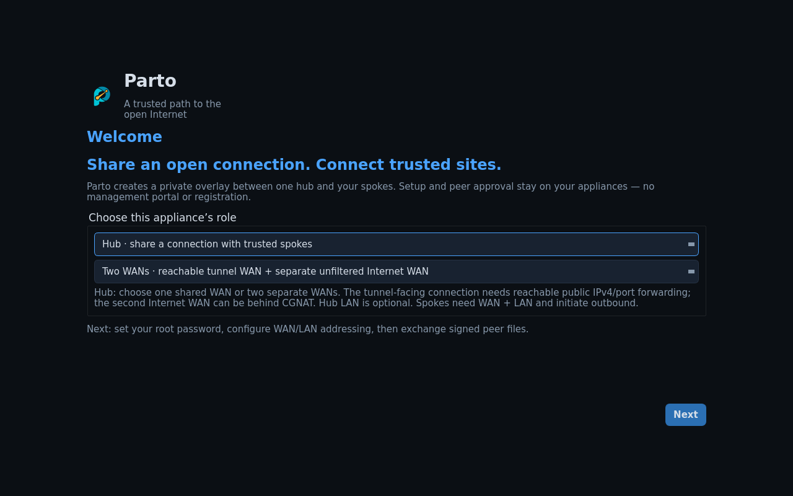

# Parto

A free, open-source virtual appliance for a small routed private network. Choose
one hub and one or more spokes, exchange signed JSON files, and carry private LAN
traffic over an encrypted connection. No management portal, registration,
cloud account or license server is required.

Choose **Hub**, then its deployment on Welcome:

- **One WAN:** receive Spoke tunnels and share Internet through the same WAN.
- **Two WANs:** a reachable transport WAN receives encrypted Spoke tunnels;
  a separate unfiltered WAN (for example Starlink) provides Internet egress.

The image ships with three adapters. With all three present: **eth0 transport
WAN**, **eth1 LAN**, **eth2 Hub Internet WAN**. Single-WAN Hubs and Spokes leave
eth2 unused. A dual-WAN Hub requires all three adapters and can set its LAN to
Unused. A single-WAN Hub can also omit LAN. Spokes always need their LAN and
advertise its private subnet.

Only the Hub needs an inbound-reachable public IPv4 address or upstream port
forwarding. Spokes initiate outbound and authenticate with their approved
certificate identities, including behind shared NAT/CGNAT; they do not enter a
public endpoint. NAT traversal does not make an unreachable CGNAT Hub reachable.
The Hub can share its Internet connection and allow or block traffic between
Spokes. In dual-WAN mode, shared Internet is routed and NATed only through the
selected unfiltered WAN, with no cleartext fallback through the transport WAN.
The browser Monitor shows named peers and recent traffic. Spokes can provide DHCP
on their LAN for an access point or client VM.

## Two uses

**A — A private client VM.** Run an appliance and a client VM on a laptop. Put the
client on the appliance's isolated LAN. The client reaches private sites and,
when enabled by the hub, uses the hub's Internet connection.

**B — Physical devices behind an access point or Ethernet switch.** The laptop's
Wi-Fi provides WAN connectivity. Bridge the appliance LAN to a dedicated wired
Ethernet adapter and connect that cable to an AP's LAN port or a physical
switch. Enable DHCP on the Spoke. For Wi-Fi clients, run the AP in bridge mode
with its DHCP server disabled. Wired and wireless clients receive addresses
from the local Spoke and use the routed overlay to the Hub.

A reachable hub on a less restricted Internet connection can also serve users
of filtered networks, including people affected by censorship in Iran, Sudan,
North Korea, China or elsewhere. The underlying network must still be able to
reach the hub. This is not a connection through a complete Internet shutdown,
and TLS transport does not guarantee invisibility to filtering systems.

## Protocol options

Choose one transport for the Hub and its Spokes. All three options use BGP to
exchange routes between sites.

| Option | Description |
| --- | --- |
| IPsec + BGP | The standard site-to-site option. IPsec encrypts the connection. |
| TLS + BGP | The same site-to-site setup with TLS encryption. |
| TLS + BGP (NG) | A customized TLS variant. |

## Deployment guides

Start with [Single WAN and Dual WAN scenarios](docs/setup.md), then follow the
import guide for your host:

- [VMware ESXi Host Client](docs/esxi.md)
- [VMware Workstation Pro](docs/workstation.md)
- [VMware Fusion on Apple Silicon or Intel](docs/fusion.md)
- [Oracle VirtualBox](docs/virtualbox.md)

After wiring the Hub and each Spoke, follow the [illustrated browser wizard](docs/browser-management.md)
to exchange the invitation, request and approval files. For physical clients,
see [Spoke LAN setup for an access point or physical switch](docs/access-point.md).

## Source and license

Project code is MIT licensed. The image includes Debian and third-party programs
under their own licenses; see [third-party notices](THIRD_PARTY_NOTICES.md).
Run `APPLIANCE_ARCH=arm64 BUILD_VOLUME=standalone-public-arm64 VERSION=<fresh-version> bash appliances/standalone-overlay/build.sh`.
For AMD64 use `APPLIANCE_ARCH=amd64 BUILD_VOLUME=standalone-public-amd64`. Keep these
caches separate from other appliance builds. Docker and a Linux privileged build container are
required. Builds write local artifacts and do not upload or publish anything.

The 0.13.0 release is staged for review. Download the OVAs and checksum from the
repository’s release assets.

## Current compatibility

Apple Silicon Fusion uses the ARM64 native companion. Workstation and VirtualBox guides target AMD64/x86 hosts. VirtualBox on Apple Silicon currently boots the ARM guest but is blocked by its missing firmware UUID; use Fusion there. See the individual guides for tested scope and pending platform checks.

## Parto 0.13.0 images

| Host | Image |
| --- | --- |
| Apple Silicon Fusion | Parto-0.13.0-arm64.vmwarevm companion |
| Compatible ARM64 OVA importers | parto-0.13.0-arm64-vmware-r1.ova |
| Compatible x86-64 OVA importers | parto-0.13.0-amd64-vmware-r1.ova |

Verify the OVA files against `SHA256SUMS`. Both packages passed a full native
VMware OVF Tool import with manifest verification. The VMware revision changes
the packaging and preserves the guest disk contents.

Version 0.13.0 shows physical addresses on the console and serves HTTPS
management on the WAN interfaces only. The browser shows one hour of overlay
traffic and a role-scoped topology. See the [browser guide](docs/browser-management.md).

## Browser management in 0.11

After console password/network setup, manage Parto at HTTPS port 8443. Upload and download exchange files directly in your browser. See [browser setup](docs/browser-management.md).
