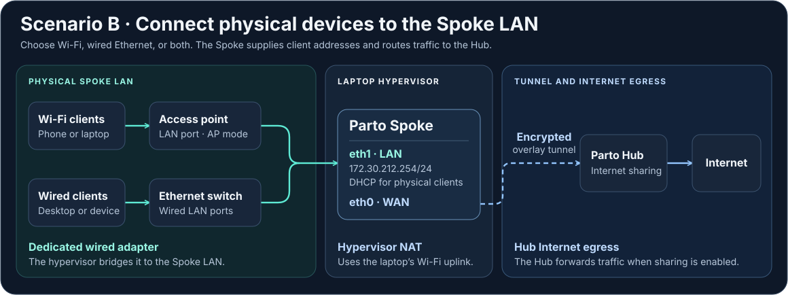
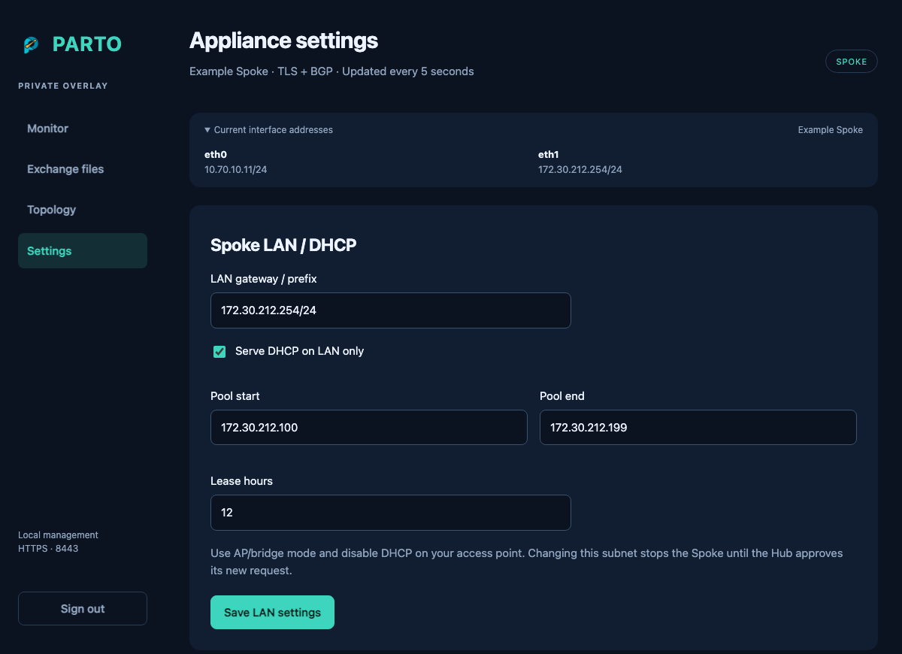

# Scenario B — Share the Spoke LAN through an access point or physical switch

The laptop keeps its normal Internet connection on Wi-Fi. The appliance WAN uses hypervisor NAT through that connection. Its LAN bridges to a **separate wired Ethernet adapter**, which connects to an access point (AP) or a physical Ethernet switch. Use the AP’s **LAN port** for Wi-Fi clients, or plug wired clients into the switch. A switch can serve both wired clients and an AP.

1. For wired clients, use an Ethernet switch on the dedicated LAN. For Wi-Fi clients, use an AP supporting bridge/access-point mode. Disable its DHCP server, NAT and router mode. Do not connect through its routed WAN port.
2. Dedicate a wired laptop Ethernet adapter to this LAN. Bind the appliance's second virtual adapter to that physical adapter, never to Wi-Fi.
3. Give the laptop wired adapter an optional static management address, for example `172.30.212.2/24`, **without a gateway or DNS**. Keep the laptop's default route through Wi-Fi. Otherwise its NAT traffic could loop back into its own appliance.
4. If using an AP, give it an address such as `172.30.212.3/24`. Its management gateway may be the spoke `172.30.212.254`; keep its address outside the DHCP pool.
5. In the spoke wizard use LAN `172.30.212.254/24`. After completing the file exchange and activating the Spoke, sign in to the Spoke’s web interface and open **Settings → Spoke LAN / DHCP**. Select **Serve DHCP on LAN only**, enter the pool `172.30.212.100`–`172.30.212.199`, and select **Save LAN settings**.
6. Connect a wired client to the switch or join a phone or laptop to the AP. It should receive a `172.30.212.x` address, gateway `172.30.212.254` and DNS servers. DHCP comes from this spoke, not from across the tunnel.
7. Enable Internet sharing on the Hub. Test Internet access, then disable sharing at the hub and confirm it stops.
8. Reboot the spoke and confirm clients can renew their leases and regain Internet access after the overlay recovers.

Parto 0.13.0 browser settings with example addresses.

Each spoke needs a **different LAN subnet**. Do not bridge the upstream home LAN into this spoke LAN. Run one DHCP server on this segment. Check the wired or Wi-Fi connection with your own equipment.
