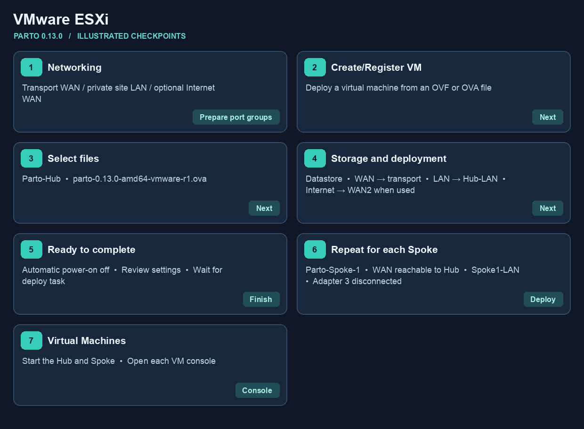
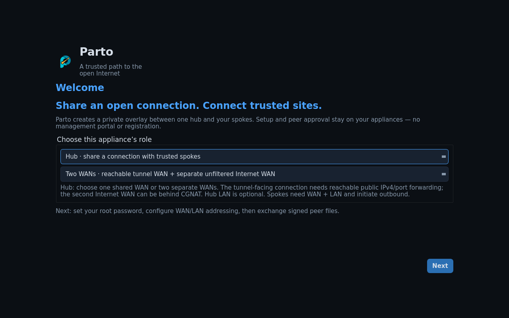

# Import Parto into VMware ESXi

Choose [Single WAN or Dual WAN](setup.md) first. Use
`parto-0.13.0-amd64-vmware-r1.ova` on an x86-64 host that supports the
image's VM hardware version 14. Keep the imported BIOS and boot disk settings.
These steps describe a standalone Host Client. For a vCenter-managed host,
use the vSphere Client's **Deploy OVF Template** action and choose the
appropriate compute resource, datastore and networks. [Broadcom reference](https://knowledge.broadcom.com/external/article/325787)

1. **Prepare the port groups.** In **Networking**, identify the transport WAN
   port group. Create or select a separate private port group for each site's
   LAN. Use an uplink-free standard switch for a same-host private LAN, or
   a dedicated VLAN where a LAN must span hosts. For a dual-WAN Hub, identify
   a third port group on the separate Internet uplink. [Port group settings screenshot, Broadcom](https://knowledge.broadcom.com/external/article/311057/configuring-vlan-on-a-vswitch-standard-p.html)
2. **Start the import.** In the Host Client, open **Virtual Machines →
   Create/Register VM** and choose **Deploy a virtual machine from an OVF or
   OVA file**. In ESX 9.1, open **Host → Actions → Deploy OVF Template**
   instead.

   

   [Broadcom Host Client screenshots, including the 9.1 Host Actions path](https://knowledge.broadcom.com/external/article/455075/unable-to-locate-option-to-deploy-ovf-te.html)
3. **Name the VM and select the file.** Enter `Parto-Hub` and select the AMD64
   OVA. Upload the whole OVA at the file selection step.
4. **Select storage.** Choose a datastore with sufficient capacity. In
   **Deployment options**, map **WAN** to the transport port group, **LAN**
   to this site's private LAN, and **Internet** to the separate Internet
   uplink only for a dual-WAN Hub. For an unused adapter, use an isolated
   placeholder if mapping is required and disconnect it before first boot.
   Leave automatic power-on off.
5. **Finish and review.** Check **Ready to complete**, choose **Finish**, and
   wait for the upload and deployment tasks to complete. Open **Edit
   settings** with the VM powered off and confirm adapter order and connection
   at power on. [Host Client wizard reference, including storage and deployment options](https://www.cisco.com/c/en/us/td/docs/dcn/nd/2x/deployment/cisco-nexus-dashboard-deployment-guide-211/nd-deploy-esx-21x.pdf)
6. **Deploy each Spoke.** Repeat with a unique name, such as `Parto-Spoke-1`.
   Adapter 1 goes to the network that can reach Hub eth0. Adapter 2 goes to
   that Spoke's private LAN port group. Leave adapter 3 disconnected. Put its
   client on the same Spoke LAN port group.
7. **Power on and open Console.** Configure each role on its own VM, then
   complete the [console setup](setup.md#2-set-up-the-hub-console) and
   [browser wizard](browser-management.md).

The numbered visual is a Parto-specific walkthrough. The linked vendor
screens show the native controls and may use a different appliance or version.
This guide describes the import workflow. The 0.13.0 packaging check used
VMware OVF Tool, and the verified end-to-end labs ran on Fusion and EVE-NG.
