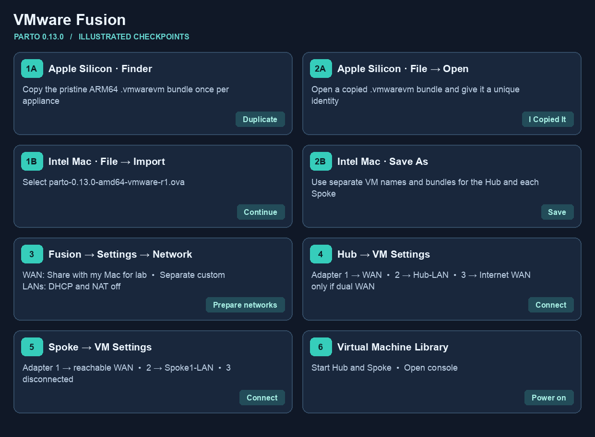
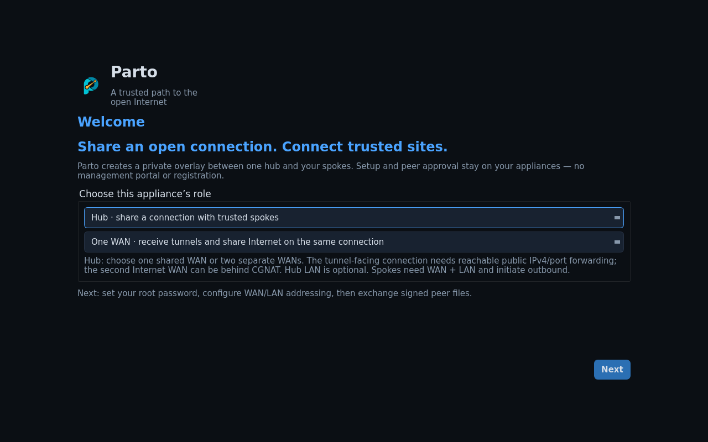

# Open or import Parto in VMware Fusion

Choose [Single WAN or Dual WAN](setup.md) first. Follow the section for your
Mac's processor, then connect the VM adapters. The numbered visual uses sample
names. The linked native screens are references from other releases or appliances.

## Apple Silicon · Open the native bundle

1. **Copy the bundle.** Extract the supplied `Parto-0.13.0-arm64.vmwarevm`
   companion if it came in an archive. In Finder make a separate copy of
   the whole pristine bundle for `Parto-Hub` and each Spoke.
2. **Open each copy.** In Fusion select **File → Open** and choose the copied
   `.vmwarevm` bundle, or double-click it in Finder. If Fusion asks whether
   it was moved or copied, select **I Copied It** so this VM gets new identity
   and MAC addresses. Use the native bundle for this Apple Silicon release.

## Intel Mac · Import the OVA

1. **Select the OVA.** In Fusion select **File → Import**, choose
   `parto-0.13.0-amd64-vmware-r1.ova`, and continue.

   
2. **Save each VM.** Save as `Parto-Hub` and finish the import. Repeat from
   the same OVA into separate bundles for `Parto-Spoke-1`, etc. Keep the
   appliances off while wiring their adapters.

   

   [Photon OS screenshot walkthrough](https://mikeroysoft.github.io/photon/docs-v3/installation-guide/run-photon-on-fusion/importing-photon-os-from-ova-on-fusion/)

## Both Mac types · Wire the adapters and start

3. **Prepare networks.** For a same-host lab use **Share with my Mac** for the
   WAN. In **Fusion → Settings → Network**, add a custom network for each
   site's private LAN, with DHCP and NAT off. If those controls are locked,
   use the padlock to authenticate locally.
4. **Wire the Hub.** Open **Virtual Machine → Settings → Network Adapter**.
   Connect adapter 1 to the WAN. Set adapter 2 to the Hub's custom LAN.
   In dual-WAN mode connect adapter 3 to the separate Internet network. For
   two physical uplinks, select each intended bridged interface explicitly.
   In single-WAN mode leave adapter 3 disconnected. [Native adapter settings screenshot, Cisco Figure 2](https://www.cisco.com/c/en/us/td/docs/cloud_services/cisco_modeling_labs/v200/admin/guide/b_cml_admin_guide_2-0/m_networking.pdf#page=4) · [Broadcom adapter controls](https://knowledge.broadcom.com/external/article/344572)
5. **Wire each Spoke.** Connect adapter 1 to the shared lab WAN or a network
   with a route to Hub eth0. Connect adapter 2 to the Spoke's own custom LAN
   and adapter 3 to no active network. Attach each client only to its site LAN.
6. **Start the Hub and Spoke.** Open the VM console and follow the
   [console setup](setup.md#2-set-up-the-hub-console) and
   [browser wizard](browser-management.md).

For physical clients, see [Spoke LAN setup for an access point or switch](access-point.md).
