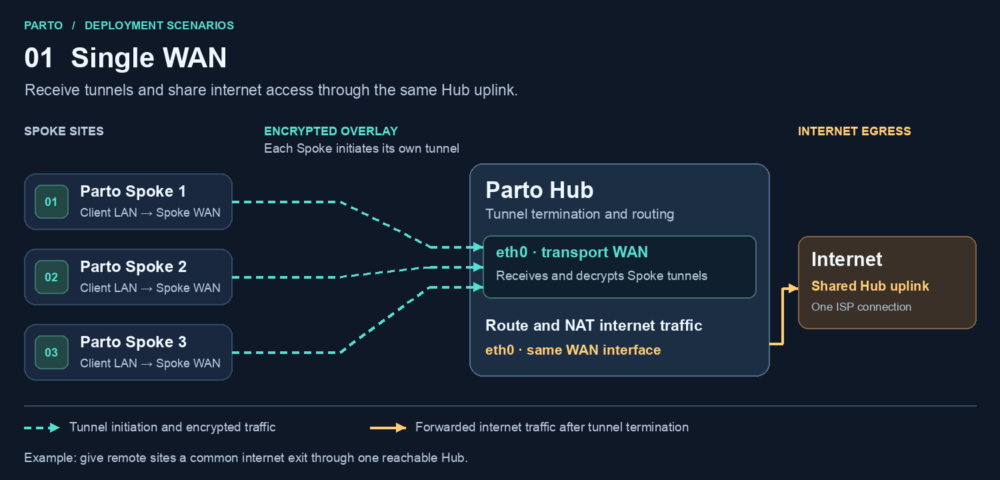
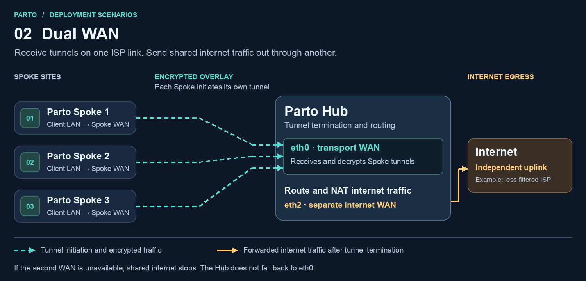
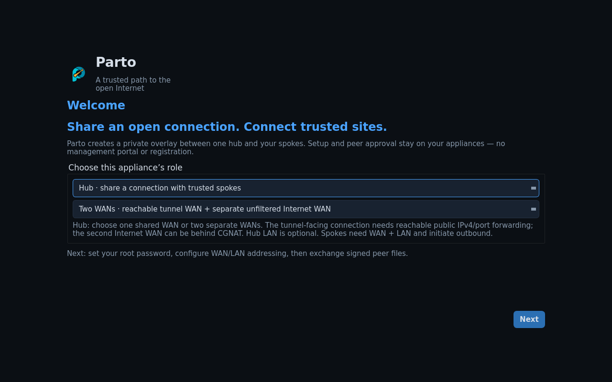
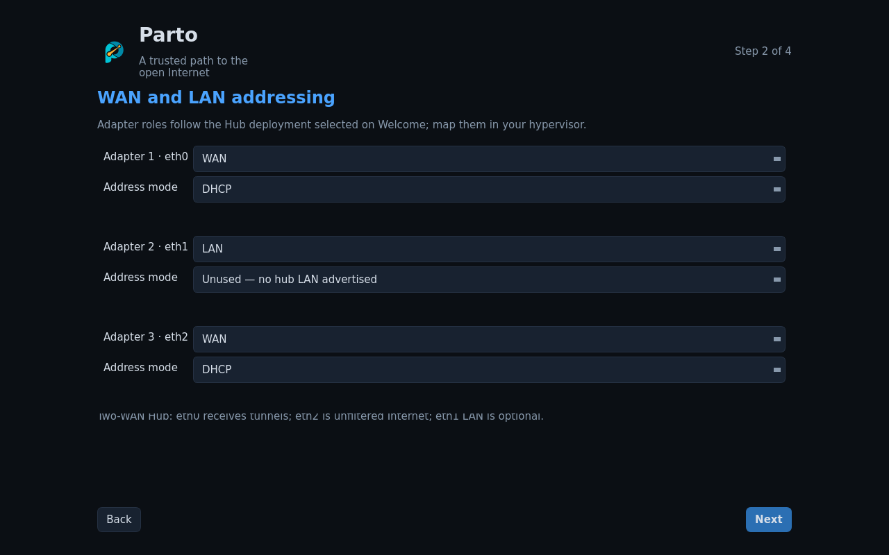

# Deploy Parto 0.13.0

## Scenario 1 · Single WAN

Use this when one Hub connection can receive the Spoke tunnels and provide
Internet access. A first test can run on one hypervisor with a shared virtual
WAN. The Spoke initiates the tunnel to the Hub. With Internet sharing enabled,
its client uses the Hub's WAN for Internet egress.

This works for remote sites that need a common internet exit through one
reachable Hub. Each site's clients connect to their own Spoke LAN.

## Scenario 2 · Dual WAN

Use this when Spokes can reach the Hub through one network but their Internet
traffic should exit through a different connection. For example, the Hub can
receive tunnels over a reachable ISP line and send shared Internet traffic
through a separate, less filtered ISP or satellite link. The transport path
must still carry the selected protocol to the Hub. If it is blocked or the
second WAN goes down, this setup cannot provide shared Internet access.

The two paths serve different jobs: Hub eth0 receives the encrypted traffic
on the reachable transport network. After terminating each tunnel, the Hub
routes and NATs shared internet traffic through eth2.

| VM and adapter | Scenario 1 | Scenario 2 |
| --- | --- | --- |
| Hub adapter 1 · eth0 | Reachable transport and shared Internet | Reachable transport only for Spoke tunnels |
| Hub adapter 2 · eth1 | Optional private Hub LAN | Optional private Hub LAN |
| Hub adapter 3 · eth2 | Unused | Separate Internet uplink |
| Spoke adapter 1 · eth0 | WAN that can reach Hub | WAN that can reach Hub |
| Spoke adapter 2 · eth1 | Private Spoke LAN | Private Spoke LAN |
| Spoke adapter 3 · eth2 | Unused | Unused |

For a lab, put appliance WANs on a shared network that supports guest-to-guest
traffic. Give each site its own LAN network. For a real dual-WAN deployment,
connect Hub adapters 1 and 3 to different physical uplinks or separately routed
networks, with distinct subnets and gateways. Two NAT networks on the same host
usually use the same physical Internet route. The dual-WAN Hub requires three
adapters even when its LAN is unused. Shared Internet traffic has no fallback
to the transport WAN.

### 1. Import and wire one VM per site

Choose your hypervisor and create a fresh VM for the Hub and for each Spoke.

| Platform | Parto artifact | Illustrated import guide |
| --- | --- | --- |
| VMware ESXi on x86-64 | AMD64 VMware OVA | [ESXi Host Client](esxi.md) |
| VMware Workstation Pro on x86-64 | AMD64 VMware OVA | [Workstation](workstation.md) |
| VMware Fusion on Apple Silicon | ARM64 native `.vmwarevm` bundle | [Fusion](fusion.md#apple-silicon--open-the-native-bundle) |
| VMware Fusion on Intel Mac | AMD64 VMware OVA | [Fusion](fusion.md#intel-mac--import-the-ova) |
| Oracle VirtualBox on x86-64 | AMD64 VMware OVA | [VirtualBox](virtualbox.md) |

Use the matching release artifact and verify it against [SHA256SUMS](../SHA256SUMS).
Start with one Spoke and a client connected only to that Spoke's LAN.
Create fresh VM identities and MAC addresses on each import.

### 2. Set up the Hub console

1. Open the VM console. On **Welcome**, choose **Hub**, then **One WAN** or
   **Two WANs** as shown above. Select **Next**.
2. Set and confirm a unique root password for this appliance.
3. Under **WAN and LAN addressing**, choose DHCP with a reservation or assign a
   static address, gateway and DNS for eth0. In dual-WAN mode, also configure
   eth2 with the Internet uplink's address and gateway. For eth1 choose a
   static LAN prefix with no upstream gateway, or **Unused**.
4. Continue and apply the network settings. Wait for the console to show the
   HTTPS management address.

### 3. Set up each Spoke console

1. Open its VM console. On **Welcome**, choose **Spoke**, then set and confirm
   that appliance's own root password.
2. Configure eth0 using DHCP or a static IPv4 address, gateway and DNS on the
   local WAN. It needs a route to the Hub endpoint. It can be behind NAT.
3. Configure eth1 with a unique static LAN prefix. Do not set an upstream
   gateway on the LAN adapter. Leave eth2 unused and apply the network settings.
4. Connect a client to that site's LAN. Give it a local address and use that
   Spoke's LAN IP as its default gateway. For LAN DHCP or physical clients, see
   [access point or switch setup](access-point.md).

| Example | Hub | Spoke 1 | Spoke 2 |
| --- | --- | --- | --- |
| Lab eth0 IPv4 | `10.70.10.10/24` | `10.70.10.11/24` | `10.70.10.12/24` |
| Appliance LAN | `172.30.211.254/24` or Unused | `172.30.212.254/24` | `172.30.213.254/24` |
| Client IPv4 | `172.30.211.10/24` if used | `172.30.212.10/24` | `172.30.213.10/24` |

Use your actual WAN subnet, gateway and DNS. Reserve static addresses outside
the DHCP pool. If using the example client addresses, their respective gateways
are the matching `.254` addresses. For a two-WAN example, eth2 can use
`10.70.20.10/24` on an independently routed uplink.

### 4. Confirm transport and management reachability

In the browser wizard the **Reachable Hub IPv4** is the address each Spoke can
actually reach. On the same routed lab network, use the Hub's eth0 address.
Across the Internet, use the Hub transport router's public IPv4 and forward the
chosen transport to Hub eth0. The Spoke does not need an inbound port forward.

| Transport | Reachable on Hub eth0 |
| --- | --- |
| TLS + BGP or TLS + BGP (NG) | TCP 443 |
| IPsec + BGP | UDP 500 and 4500 |
| Local administration | HTTPS TCP 8443 from a trusted WAN-side network |

If the Hub's transport ISP uses CGNAT, a local router port forward alone cannot
make it reachable. Obtain an inbound-reachable transport connection. The
second WAN only needs outbound Internet access and may use CGNAT.

### 5. Create, approve and activate the sites

Follow the [illustrated Hub and Spoke browser wizard](browser-management.md).
It shows every invitation, request and approval screen in the order the two
operators use them.
