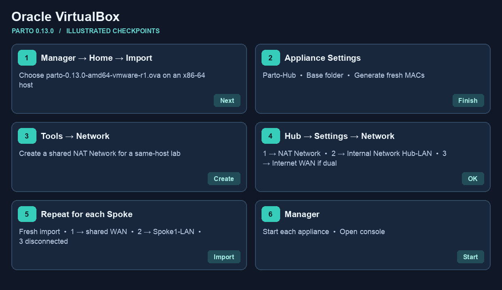
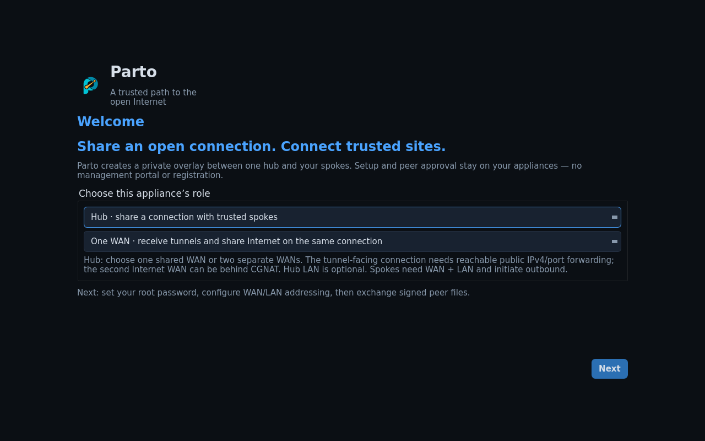

# Import Parto into Oracle VirtualBox

Choose [Single WAN or Dual WAN](setup.md) first. Use the
`parto-0.13.0-amd64-vmware-r1.ova` on an **x86-64 host**. The ARM VirtualBox
test reached Linux but lacked the firmware UUID needed by Parto to create a
safe VM identity. Use the Fusion companion on Apple Silicon. The reference
screens below use a different appliance.

1. **Select the OVA.** Open VirtualBox Manager and use **Home → Import**,
   called **File → Import Appliance** in some versions. Browse to the
   AMD64 OVA.

   
2. **Review Appliance Settings.** Name it `Parto-Hub` and choose a base
   folder. Use a MAC policy that generates new addresses for all adapters.
   Keep the supplied boot disk, BIOS and adapter order. Select **Finish**
   or **Import** and wait for the VM to appear.

   

   [Canonical screenshot walkthrough](https://ubuntu.com/docs/public-images/public-images-how-to/run-an-ova-using-virtualbox/#import-the-ova-into-the-virtualbox) · [Oracle import instructions](https://docs.oracle.com/en/virtualization/virtualbox/7.2/user/working-with-vms.html#importing-an-appliance-in-ovf-format)
3. **Create a lab WAN.** In **Tools → Network → NAT Networks**, create a
   shared NAT Network. Ordinary per-VM NAT is isolated and does not provide
   a common WAN for the Hub and Spokes. Record the subnet, gateway and DHCP
   range. The host may need a management VM on this NAT Network to reach
   the guests; connect that VM only to the trusted lab WAN. For a physical
   setup use a bridged adapter bound to the intended uplink.
4. **Wire the Hub.** In **Settings → Network**, attach adapter 1 to the NAT
   Network or intended transport bridge. Set adapter 2 to **Internal
   Network** named `Hub-LAN` if used. In dual-WAN mode attach adapter 3 to
   the separate Internet uplink. In single-WAN mode leave its cable
   disconnected. Use **Cable Connected** on the adapters you need.
5. **Import and wire a Spoke.** Repeat the import with a distinct name and
   MACs. Connect adapter 1 to the shared lab WAN or the Spoke's real WAN
   with a route to the Hub. Connect adapter 2 to its own **Internal
   Network**, e.g. `Spoke1-LAN`. Attach its client only to that same network.
   Leave adapter 3 disconnected. [Oracle network settings reference](https://docs.oracle.com/en/virtualization/virtualbox/7.2/user/networkingdetails.html)
6. **Start each VM.** Click **Start**. At Parto Welcome, follow
   [Hub and Spoke console setup](setup.md#2-set-up-the-hub-console) and the
   [browser wizard](browser-management.md).

For a physical Wi-Fi client, see [Spoke LAN and access-point setup](access-point.md).
