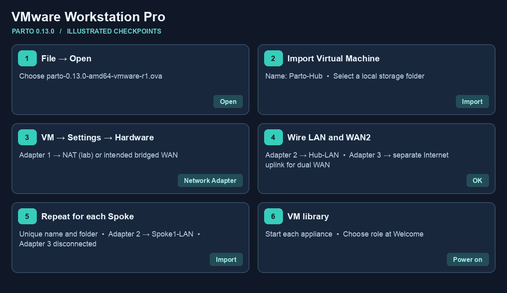
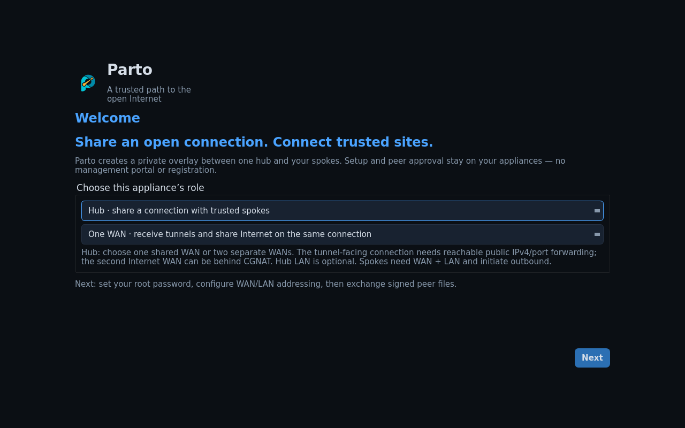

# Import Parto into VMware Workstation Pro

Choose [Single WAN or Dual WAN](setup.md) first. On an x86-64 PC use
`parto-0.13.0-amd64-vmware-r1.ova`. The numbered visual uses sample names.
Windows import of this release remains a manual check. The linked reference
screens show the native controls with a different appliance.

1. **Open the OVA.** In Workstation Pro choose **File → Open** and select the
   AMD64 OVA.

   
2. **Import the Hub.** In **Import Virtual Machine**, name it `Parto-Hub`,
   choose a local storage folder and select **Import**. Wait until it appears
   in the library. Keep the imported BIOS and boot disk settings.

   

   [Entrust screenshot walkthrough](https://nshielddocs.entrust.com/monitor-docs/install-vmware-workstation.html) · [Broadcom import reference](https://knowledge.broadcom.com/external/article/341189)
3. **Choose the WAN.** With the VM off, open **VM → Settings → Hardware**.
   Connect **Network Adapter** (adapter 1) to **NAT** for a same-host lab.
   Use **Edit → Virtual Network Editor** to check the VMnet8 subnet,
   DHCP range and gateway. For a physical WAN, bridge to the intended uplink.
   [Virtual Network Editor screenshot, Broadcom community](https://community.broadcom.com/vmware-cloud-foundation/discussion/bridged-networking-broken-in-1761)
4. **Wire the LAN and optional Internet WAN.** In adapter 2 settings choose
   **LAN Segment**, create/select `Hub-LAN`, and attach any Hub client there.
   For a dual-WAN Hub, bind adapter 3 to a separate bridged VMnet that uses
   the dedicated Internet uplink. Use a different connected subnet. In
   single-WAN mode, leave adapter 3 disconnected. Check **Connect at power
   on** for used adapters.
5. **Import the Spoke.** Repeat **File → Open → Import** with a separate name
   and storage folder. Connect adapter 1 to the shared lab WAN or the
   Spoke's reachable WAN, adapter 2 to a different LAN Segment such as
   `Spoke1-LAN`, and leave adapter 3 disconnected. Connect the client
   only to the Spoke segment.
6. **Start each VM.** Select **Power on this virtual machine**. Follow
   [Hub and Spoke console setup](setup.md#2-set-up-the-hub-console) and the
   [browser wizard](browser-management.md).

If the importer reports an OVF conformance or checksum error, first verify
the downloaded VMware OVA against [SHA256SUMS](../SHA256SUMS). Retain the
importer error and check the Workstation version before proceeding.
